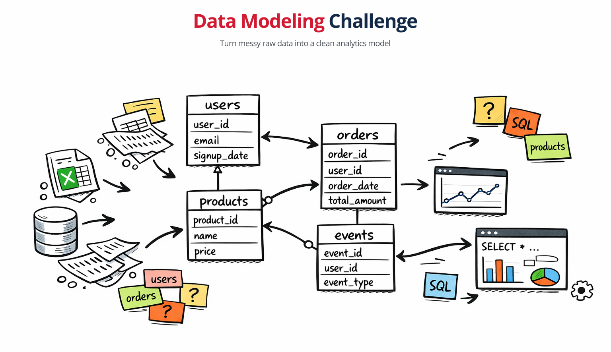

Practice data modeling for analytics, from your first fact table to a full star schema.

This repository is a self-paced challenge for **junior data analysts and analytics engineers** who want to learn **dimensional modeling**. It includes a realistic dataset, task prompts based on business problems, short theory for each task, and a template where you document your solution.

> **Status: beta.** The challenge has not been tested with many learners yet, so you may find rough edges. Your feedback is very welcome: see [Feedback](#feedback).

## What you will practice

- Translating raw operational data into an analytics-friendly model
- Declaring the **grain** of a table and avoiding fan-out when joining
- Designing **fact and dimension tables** and putting them together in a star schema
- Modeling behavioral **event data** (funnels, enriched events)
- Documenting assumptions, trade-offs, and modeling decisions

You only need basic SQL to start: `SELECT`, `JOIN`, `GROUP BY` and `CASE`. Everything else is explained in the theory files.

## Getting started

1. Follow [GETTING_STARTED.md](GETTING_STARTED.md) to load the dataset into DuckDB (in your browser, on your computer, or from Python). It takes about five minutes.
2. Read the [dataset documentation](data/ecommerce.md) to get to know the tables.
3. Open the first task and start modeling.

## Data modeling tasks

| # | Task | Difficulty | Topic |
|---|---|---|---|
| 01 | [Revenue Reporting](tasks/task-01-revenue-reporting/) | ⭐️ | Grain and your first fact table |
| 02 | [Product Sales Report](tasks/task-02-product-sales-report/) | ⭐️ | Aggregation and join safety |
| 03 | [Star Schema Design](tasks/task-03-star-schema/) | ⭐️⭐️ | Dimensional modeling |
| 04 | [Hotel Booking Data Marts](tasks/task-04-hotel-booking-marts/) | ⭐️⭐️ | Dimensional design without data |
| 05 | [User Conversion Funnel](tasks/task-05-conversion-funnel/) | ⭐️⭐️⭐️ | Behavioral modeling |
| 06 | [Event Enrichment & Cart Abandonment](tasks/task-06-cart-abandonment/) | ⭐️⭐️ | Behavioral modeling |

Tasks 01–03 and 05–06 use the e-commerce dataset. Task 04 is a design exercise in a different domain (hotel bookings), with no data at all.

You can solve the tasks in any order. If you're just starting with data modeling, go in order: each task builds on ideas from the previous ones. The [tasks overview](tasks/README.md) explains what each task teaches.

### What's inside a task folder

| File | What it's for |
|---|---|
| `README.md` | Short summary of the task, with links to the other files |
| `TASK.md` | The task itself: **context** (the business problem), **goal** (what to build), **deliverables**, and collapsible **hints** |
| `THEORY.md` | The theory you need for the task, with definitions, examples and common pitfalls. Read it first if a concept is new to you, or come back when you get stuck |
| `SOLUTION.md` | Your space: a template where you describe your model, your reasoning, and your SQL |

Tasks 01–03 also include a `checks.sql` file that tests your model automatically.

Task 01 has an [example solution](reference-solutions/task-01-revenue-reporting/SOLUTION.md) you can read before you start, so you can see what a complete answer looks like.

## Suggested workflow

1. **Understand the source model**  
	Inspect each table, identify entity boundaries, and note data quality constraints.
2. **Define the target model**  
	Decide on the analytical grain, fact tables, dimension tables, and key relationships.
3. **Document assumptions**  
	Capture unclear business rules and how you resolved them.
4. **Validate consistency**  
	Reconcile totals, record counts, and foreign-key relationships where possible.
5. **Present final artifacts**  
	Provide diagrams, table definitions, and concise rationale.

## What a solution contains

Every `SOLUTION.md` has the same three layers:

- **Conceptual model** — the business entities, how they relate, and the grain of your output, in plain language. A whiteboard sketch or diagram helps.
- **Logical model** — tables, columns, data types and keys. An ERD works well here.
- **Physical model** — the SQL that builds the model. (Task 04 is design-only, so it asks for a mapping to business questions instead.)

Add notes on your assumptions, design trade-offs, and the validation checks you ran.

## Checking your work

- **Automatic checks (Tasks 01–03):** run the task's `checks.sql` against your model. It compares your model with the source data (row counts, totals, unique and non-NULL keys, correct joins) and prints `PASS` or `FAIL` for each check, with the expected and actual values.
- **Validation in the hints:** every task also lists validation checks you can write yourself. Writing them is part of the skill.
- **Reference solutions:** when your checks pass, compare your reasoning with the [reference solutions](reference-solutions/) (Tasks 01–03 for now). Modeling has trade-offs, so a different but well-argued answer is fine.
- Keep your solution practical and explainable. Prefer clarity over unnecessary complexity, and make assumptions explicit when the requirements are ambiguous.

## Feedback

This is an early version, and the most useful thing you can do is tell me what didn't work: unclear instructions, a task that was too hard or too easy, a mistake in the theory, a check that fails on a correct answer. Please [open an issue](https://github.com/oleg-agapov/data_modeling_challenge/issues) on GitHub.

## Repository structure

| Folder / file | Contents |
|---|---|
| [GETTING_STARTED.md](GETTING_STARTED.md) | How to set up DuckDB and load the data |
| [setup.sql](setup.sql) | Script that creates the source tables |
| [data/](data/) | The e-commerce dataset and its documentation |
| [tasks/](tasks/) | The challenge tasks |
| [reference-solutions/](reference-solutions/) | Complete solutions (spoilers!) |
| [materials/](materials/) | Books, videos and guides for further study |

## License

[MIT](LICENSE)
