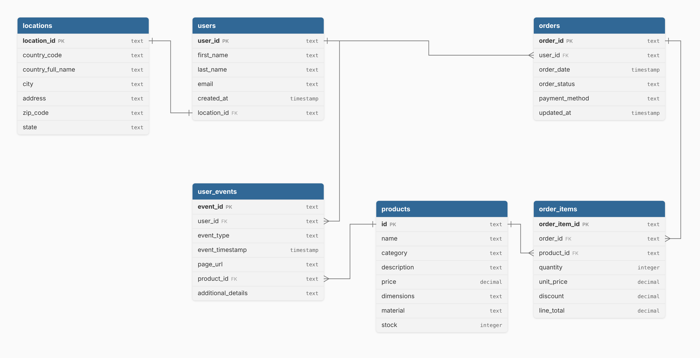

# E-commerce dataset

This document describes the six CSV files in [`data/ecommerce/`](ecommerce/).

The data is **synthetic**. It was generated to look like the operational database of a small online **furniture store** in the United States. It covers two years, from **2024-03-15 to 2026-03-15**. Names, emails and addresses are fake.

The same schema is available as DBML in [`ecommerce/schema.dbml`](ecommerce/schema.dbml). You can paste it into [dbdiagram.io](https://dbdiagram.io) to explore it.

## Dataset overview

| File | What it contains | Grain (one row is…) | Rows | Primary key |
|---|---|---|---:|---|
| `users.csv` | Registered customers | one user account | 12,483 | `user_id` |
| `locations.csv` | Customer addresses | one address | 12,483 | `location_id` |
| `products.csv` | Product catalog | one product | 21 | `id` |
| `orders.csv` | Order headers | one order | 1,918 | `order_id` |
| `order_items.csv` | Order lines | one product line in an order | 2,092 | `order_item_id` |
| `user_events.csv` | Website clickstream | one tracked event | 191,157 | `event_id` |

All primary keys are UUID strings and are unique. Timestamps have no time zone and have microsecond precision (for example `2024-08-23 22:34:47.218471`).

## Relationships

| From | To | Cardinality |
|---|---|---|
| `users.location_id` | `locations.location_id` | one-to-one: each user has exactly one address, and no address is shared |
| `orders.user_id` | `users.user_id` | many-to-one: a user has zero or more orders |
| `order_items.order_id` | `orders.order_id` | many-to-one: an order has one or more lines |
| `order_items.product_id` | `products.id` | many-to-one |
| `user_events.user_id` | `users.user_id` | many-to-one: every user has at least one event |
| `user_events.product_id` | `products.id` | many-to-one, optional: only set for product views and add-to-cart events |

Every foreign key resolves. There are no orphan rows in any table.

## `users.csv`

**Grain:** one row per registered user.

| Column | Type | Description |
|---|---|---|
| `user_id` | UUID | Unique user identifier. |
| `first_name` | string | First name. |
| `last_name` | string | Last name. |
| `email` | string | Email address. **Not unique**: see [Known quirks](#known-quirks). |
| `created_at` | timestamp | When the account was created (the sign-up time). |
| `location_id` | UUID | The user's address. Foreign key to `locations.location_id`. |

No column contains NULLs.

## `locations.csv`

**Grain:** one row per address. Each address belongs to exactly one user, so this table is effectively the user's address split into its own table.

| Column | Type | Description |
|---|---|---|
| `location_id` | UUID | Unique address identifier. |
| `country_code` | string | ISO country code. Always `US`. |
| `country_full_name` | string | Country name. Always `United States`. |
| `city` | string | City (about 9,200 distinct values). |
| `address` | string | Street address line. |
| `zip_code` | string | 5-digit ZIP code. Keep it as a string: 1,160 codes start with `0`. |
| `state` | string | US state name (50 distinct values). |

No column contains NULLs.

## `products.csv`

**Grain:** one row per product. The catalog has 21 products, 7 in each of three categories.

Note that in this file the primary key `id` is the **last** column.

| Column | Type | Description |
|---|---|---|
| `name` | string | Product name, for example `Modular Sofa`. |
| `category` | string | One of `Living Room`, `Bedroom`, `Kitchen`. |
| `description` | string | Marketing description (may contain commas, so it is quoted in the CSV). |
| `price` | decimal | Current catalog price, from 49.00 to 1,299.99. |
| `dimensions` | string | Free text, `width x depth x height` in cm, for example `220 x 90 x 75`. |
| `material` | string | Main material, for example `Solid Oak Wood`. |
| `stock` | integer | Units in stock at the time of the export (a single snapshot, no history). |
| `id` | UUID | Unique product identifier. |

## `orders.csv`

**Grain:** one row per order (the order header).

| Column | Type | Description |
|---|---|---|
| `order_id` | UUID | Unique order identifier. |
| `user_id` | UUID | Customer who placed the order. Foreign key to `users.user_id`. |
| `order_date` | timestamp | When the order was placed. |
| `order_status` | string | Current status: `pending` (483), `shipped` (502), `delivered` (470), `cancelled` (463). |
| `payment_method` | string | `paypal` (678), `bank transfer` (632), `credit card` (608). |
| `updated_at` | timestamp | When the order record was last updated. **Always equal to `order_date`** in this dataset. |

Only the current status is stored. There is no status history, and no shipping or delivery dates.

1,767 users (about 14%) have at least one order: 1,621 have one order, 141 have two, and 5 have three.

## `order_items.csv`

**Grain:** one row per product line inside an order.

| Column | Type | Description |
|---|---|---|
| `order_item_id` | UUID | Unique order line identifier. |
| `order_id` | UUID | Parent order. Foreign key to `orders.order_id`. |
| `product_id` | UUID | Product bought. Foreign key to `products.id`. |
| `quantity` | integer | Units bought. Always `1` in this dataset. |
| `unit_price` | decimal | Price per unit charged on this order. See [Known quirks](#known-quirks). |
| `discount` | decimal | Discount **rate** applied to the line, not an amount: `0` (1,696 lines), `0.1`, `0.15` or `0.2`. |
| `line_total` | decimal | Amount charged for the line: `quantity * unit_price * (1 - discount)`, rounded to 2 decimals. |

Most orders have a single line: 1,760 orders have 1 line, 142 have 2, and 16 have 3. Every order has at least one line, and every product has been sold at least once.

To get the discount as money, compute `quantity * unit_price * discount`.

## `user_events.csv`

**Grain:** one row per tracked website event.

| Column | Type | Description |
|---|---|---|
| `event_id` | UUID | Unique event identifier. |
| `user_id` | UUID | User who triggered the event. Foreign key to `users.user_id`. Every event belongs to a registered user; there is no anonymous traffic. |
| `event_type` | string | `user_sign_up`, `page_view` or `add_to_cart`. |
| `event_timestamp` | timestamp | When the event happened. |
| `page_url` | string | Page path where the event happened (see table below). |
| `product_id` | UUID, nullable | Product involved. Set only for product page views and add-to-cart events. |
| `additional_details` | string, nullable | Reserved for extra metadata. **Always empty.** |

Event types and pages:

| `event_type` | `page_url` | `product_id` | Rows |
|---|---|---|---:|
| `user_sign_up` | `/signup` | NULL | 12,483 |
| `page_view` | `/catalog` | NULL | 63,423 |
| `page_view` | `/product` | set | 103,037 |
| `page_view` | `/checkout` | NULL | 2,405 |
| `page_view` | `/about_us` | NULL | 1,613 |
| `add_to_cart` | `/product/add_to_cart` | set | 8,196 |

Things to know before modeling events:

- **There is no purchase event.** Purchases exist only in `orders`. A `/checkout` page view is not a purchase.
- Every user has exactly one `user_sign_up` event, and its timestamp is equal to `users.created_at`.
- **Each user has a single, short visit.** All of a user's events happen within about 12 minutes of sign-up, and consecutive events are never more than 60 seconds apart. Orders are placed a few minutes after sign-up (between 1.5 and 9 minutes).
- **Timestamps are not unique per user.** At sign-up, the `user_sign_up` event and up to 9 `/catalog` page views share exactly the same timestamp. If you need a strict order of events, add a tie-breaker (for example `event_id`), and be aware that the order inside such a group is arbitrary.
- Funnel coverage: 12,483 users signed up, 12,330 viewed a product, 5,559 added something to the cart, 2,171 viewed the checkout page, and 1,767 placed an order. Every user who placed an order also added that product to the cart.

## Known quirks

The dataset is clean (no NULLs in required fields, no orphan keys, no duplicate keys). It still has a few oddities you should know about:

1. **`unit_price` does not always match the product.** In 166 of 2,092 order lines (153 orders), `unit_price` equals the catalog price of a *different* product. For example, the `Luna Side Table` (catalog price 139.50) appears with a `unit_price` of 899.00. Treat `unit_price` and `line_total` as the amounts actually charged, and do not use them to compare selling price against catalog price.
2. **Duplicate emails.** 616 users share an email with at least one other user (there are 317 more user rows than distinct emails). Use `user_id`, not `email`, to identify a user.
3. **Add-to-cart events are not linked to product views.** 2,217 `add_to_cart` events are for a product the user never viewed, and another 3,336 come before the user's first view of that product.
4. **No history.** `orders.updated_at` always equals `order_date`, and `products.stock` and `products.price` are single snapshots. The data cannot show how anything changed over time.

## Modeling tips

- Store money columns as a fixed-precision type such as `DECIMAL(12,2)` rather than a float.
- `products.price` is the current catalog price. `order_items.unit_price` and `line_total` are what was charged at the time of the order.
- Use `orders` + `order_items` for sales facts, and `user_events` for behavioral facts.
- Because users and locations are one-to-one, address fields can be treated as attributes of the customer.
- Decide early whether cancelled orders count as sales, and state your choice.
