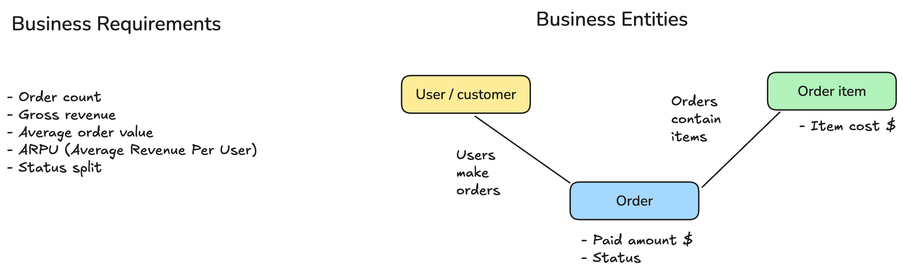
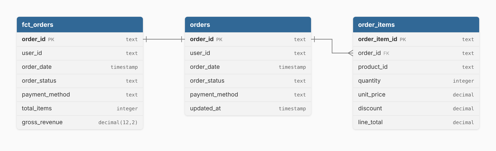

# Reference solution 01 – Revenue Reporting

## Conceptual Layer



First I just tried to figure out which real-world things matter for this task, ignoring all the table/column stuff for now.

The way I see it, there are three main things going on:

- **Customer** — someone who has an account and can buy stuff
- **Order** — one purchase a customer made
- **Order Item** — a single product line within that purchase

I noticed there are also `Products` and `Locations` tables in the dataset, but I decided to leave them out — the task is asking about revenue at the order level, and everything I need for that is already in the order items. No need to drag in product details or customer locations.

The relationships between these three things are pretty straightforward:

```
Customer - Order - Order Item
```

A customer can have many orders, and each order can have many line items. That's it.

Now, the output I want is one row per order that tells me: who placed it, when, what status it's in, and how much money it made. Once I have that, I can calculate any metric I need — total revenue, average order value, revenue per user, breakdowns by status, etc.

| Metric | How I'd calculate it |
|---|---|
| **Order count** | `COUNT(order_id)` |
| **Gross revenue** | `SUM(gross_revenue)` |
| **Average Order Value (AOV)** | `SUM(gross_revenue) / COUNT(order_id)` |
| **ARPU** | `SUM(gross_revenue) / COUNT(DISTINCT user_id)` |
| **Revenue by status** | `GROUP BY order_status` |


## Logical Layer



Here I mapped out the actual tables and columns I'll be working with. I'm keeping it database-agnostic for now, just types and relationships.

### Source tables I'm using

- **`orders`** — the main table. I'm pulling `order_id`, `user_id`, `order_date`, `order_status`, and `payment_method`.
- **`order_items`** — this is where the actual money is. I'm using `order_id`, `quantity`, and `line_total` (which already accounts for discounts).

### Output: `fct_orders`

One row per order. Here's what I want in the final table:

| Column | Type | Where it comes from | Notes |
|---|---|---|---|
| `order_id` | UUID | `orders.order_id` | PK |
| `user_id` | UUID | `orders.user_id` | |
| `order_date` | TIMESTAMP | `orders.order_date` | |
| `order_status` | VARCHAR | `orders.order_status` | |
| `payment_method` | VARCHAR | `orders.payment_method` | |
| `total_items` | INTEGER | `SUM(order_items.quantity)` | |
| `gross_revenue` | DECIMAL(10,2) | `SUM(order_items.line_total)` | |


### Design decisions I made

1. **I kept cancelled orders in.** I didn't filter them out at the model level. If someone wants only delivered orders, they can filter on `order_status` themselves. The model shouldn't make that decision for them.

2. **I aggregated `order_items` before joining.** This is important — if I just joined `orders` to `order_items` directly, I'd get one row per line item, not per order. So I group by `order_id` first, then join. Otherwise the row count explodes and revenue gets double-counted.


## Physical Layer

### `fct_orders`

I'm saving the model as a view, so I can query it by name in the validation queries (and so `checks.sql` can find it).

```sql
CREATE OR REPLACE VIEW fct_orders AS

-- Aggregate order_items first so we don't get duplicate order rows
WITH order_aggregates AS (
    SELECT
        order_id,
        SUM(quantity)   AS total_items,
        SUM(line_total) AS gross_revenue
    FROM order_items
    GROUP BY order_id
)

SELECT
    o.order_id,
    o.user_id,
    o.order_date,
    o.order_status,
    o.payment_method,
    COALESCE(oa.total_items, 0)   AS total_items,
    COALESCE(oa.gross_revenue, 0) AS gross_revenue
FROM orders o
LEFT JOIN order_aggregates oa ON oa.order_id = o.order_id;
```

### Validation queries

```sql
-- 1. Make sure there's one row per order (no fan-out)
SELECT
    COUNT(*)                 AS total_rows,
    COUNT(DISTINCT order_id) AS distinct_orders,
    (SELECT COUNT(*) FROM orders) AS source_orders
FROM fct_orders;

-- 2. Revenue reconciles with the source
SELECT
    (SELECT SUM(gross_revenue) FROM fct_orders) AS model_revenue,
    (SELECT SUM(line_total) FROM order_items)   AS source_revenue;

-- 3. Top-level business metrics
SELECT
    COUNT(order_id)                                        AS order_count,
    SUM(gross_revenue)                                     AS total_gross_revenue,
    ROUND(SUM(gross_revenue) / COUNT(order_id), 2)         AS aov,
    ROUND(SUM(gross_revenue) / COUNT(DISTINCT user_id), 2) AS arpu
FROM fct_orders;

-- 4. Orders and revenue split by status
SELECT
    order_status,
    COUNT(order_id)                                                       AS order_count,
    ROUND(SUM(gross_revenue), 2)                                          AS revenue,
    ROUND(SUM(gross_revenue) / SUM(SUM(gross_revenue)) OVER () * 100, 1)  AS revenue_pct
FROM fct_orders
GROUP BY order_status
ORDER BY revenue DESC;
```

Results I got:

- 1,918 rows and 1,918 distinct orders, the same as the source. No fan-out.
- Revenue 838,870.67 in both the model and the source.
- AOV 437.37, ARPU 474.74 (1,767 users have orders).
- The four statuses are roughly balanced: shipped 26.4% of revenue, pending 25.3%, cancelled 24.8%, delivered 23.5%.

Finally, I ran [`checks.sql`](../../tasks/task-01-revenue-reporting/checks.sql) and all checks passed.
