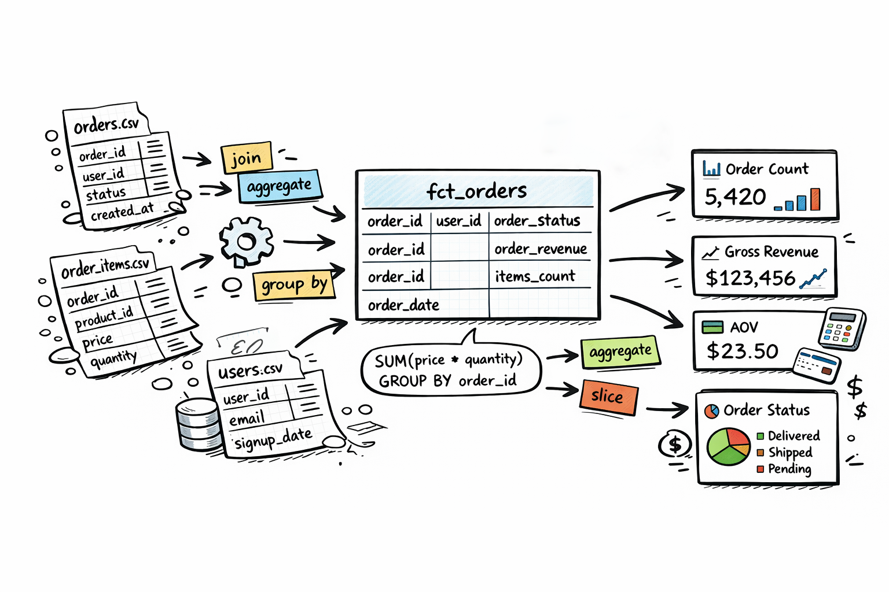

# Task 01 – Revenue Reporting

Build an order-level fact table that serves as a foundation for revenue reporting.

**Difficulty**: Easy ⭐️

- **Task**: [TASK.md](TASK.md)
- **Theory**: [The Three Layers of Data Modeling](THEORY.md)
- **Solution template**: [SOLUTION.md](SOLUTION.md)
- **Checks**: [checks.sql](checks.sql)
- **Example solution**: [reference solution](../../reference-solutions/task-01-revenue-reporting/SOLUTION.md) (for this task it's fine to read it before you start)
