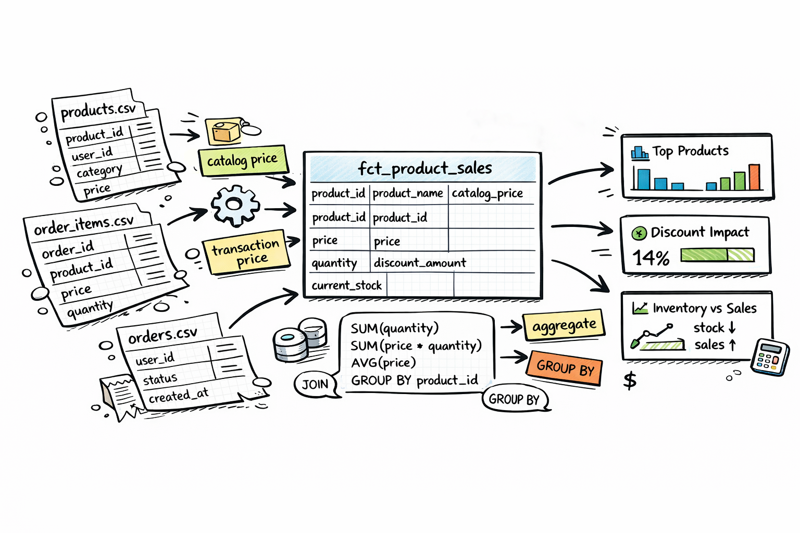

# Task 02 – Product Sales Report

Build a product-level sales report aggregating sales metrics per product.

**Difficulty**: Easy ⭐️

- **Task**: [TASK.md](TASK.md)
- **Theory**: [Grain Choices, Aggregation Patterns, and Join Safety](THEORY.md)
- **Solution template**: [SOLUTION.md](SOLUTION.md)
- **Checks**: [checks.sql](checks.sql)
